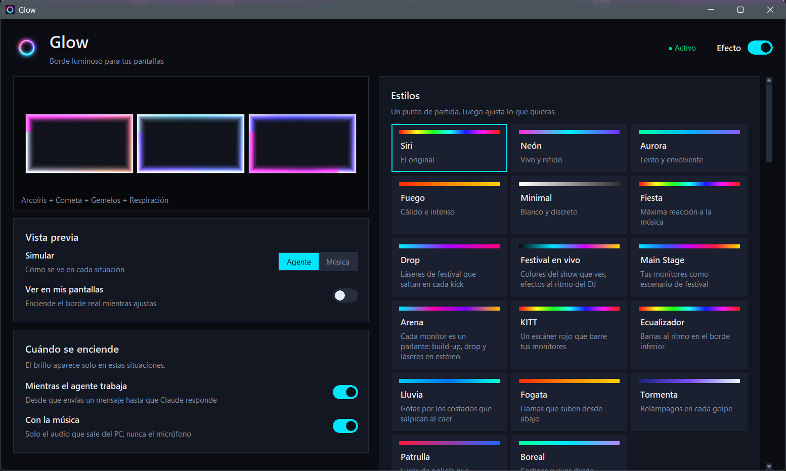

# GLOW

### Borde luminoso animado para tus pantallas en Windows

[](https://github.com/pablo29855/Glow/releases/latest)
[](https://github.com/pablo29855/Glow/actions/workflows/tests.yml)

GLOW dibuja un brillo de colores en los bordes de tus monitores, al estilo de Siri. Se enciende mientras un agente de IA trabaja o cuando suena música en el PC, y late al ritmo de lo que escuchas.



---

## Descargar

El instalador trae todo lo necesario. No hace falta instalar Python.

| Sistema | Archivo | Instalación |
|---|---|---|
| **Windows 10/11** (64 bits) | [GLOW-Setup.exe](https://github.com/pablo29855/Glow/releases/latest/download/GLOW-Setup.exe) | [Guía de instalación](docs/instalacion.md) |

El instalador no está firmado, así que Windows muestra un aviso la primera vez. La [guía de instalación](docs/instalacion.md) explica cómo continuar, cómo actualizar y cómo resolver los problemas más comunes.

---

## Qué hace

- **Brillo sin cortes.** Cuatro franjas finas abrazan los bordes de cada monitor y se funden con el escritorio. Las esquinas se unen sin saltos de color.
- **Ligero.** Solo se dibujan las franjas del borde, nunca la pantalla entera, así que el escritorio sigue fluido.
- **Al ritmo de la música.** Analiza solo el audio que sale del PC, nunca el micrófono. Detecta golpes de bajo, agudos y estéreo: los monitores de la izquierda siguen el canal izquierdo y los de la derecha, el derecho.
- **14 animaciones.** Arcoíris, cometa, gemelos, respiración, drop, escenario, arena, escáner, ecualizador, lluvia, fuego, tormenta, sirena y aurora.
- **Estilos listos.** Siri, Neón, Aurora, Fuego, Minimal, Fiesta, Festival en vivo, KITT y más, como punto de partida.
- **Colores de la pantalla.** En modo *pantalla*, toma los colores de lo que estás viendo y destella con los flashes del video.
- **Perfiles.** Guarda tus ajustes favoritos y cámbialos con un clic.
- **Mientras el agente trabaja.** Se enciende desde que envías un mensaje a Claude hasta que responde (ver [Agentes de IA](#agentes-de-ia)).
- **Inicio con Windows.** Opcional, desde los ajustes.

---

## Ajustes

Abre **GLOW** desde el menú Inicio. Los cambios se aplican al momento y se guardan solos.

| Sección | Qué contiene |
|---|---|
| **Vista previa** | Simula cómo se ve con el agente o con música, y enciende el borde real mientras ajustas. |
| **Cuándo se enciende** | Mientras el agente trabaja y con la música. |
| **Estilos** | Estilos listos y tus perfiles guardados. |
| **Animaciones** | Elige qué animaciones se usan. |
| **Color** | Colores de cada animación, uno solo, tu paleta o los colores de la pantalla. |
| **Apariencia** | Brillo, tamaño y suavidad del borde. |
| **Reacción a la música** | Sensibilidad a los golpes y opciones avanzadas. |
| **Sistema** | Inicio con Windows y valores de fábrica. |

### Agentes de IA

GLOW se controla desde la línea de comandos:

```bat
GLOW.exe on      :: enciende el brillo (arranca GLOW si hace falta)
GLOW.exe off     :: lo apaga
GLOW.exe quit    :: cierra GLOW
```

Para que brille mientras Claude Code trabaja, añade estos hooks a `%USERPROFILE%\.claude\settings.json`:

```json
{
  "hooks": {
    "UserPromptSubmit": [{ "hooks": [{ "type": "command", "command": "\"%LOCALAPPDATA%\\Programs\\GLOW\\GLOW.exe\" on" }] }],
    "Stop": [{ "hooks": [{ "type": "command", "command": "\"%LOCALAPPDATA%\\Programs\\GLOW\\GLOW.exe\" off" }] }]
  }
}
```

---

## Ejecutar desde el código

Necesitas Python 3.13 o superior en Windows.

```bash
git clone https://github.com/pablo29855/Glow.git
cd Glow
pip install -r requirements.txt
pythonw glow_ui.py
```

Self-check (sin pantalla real ni audio):

```bash
python glow.py check
```

### Construir el instalador

```bash
pip install pyinstaller
python installer/build.py
```

Congela la app con PyInstaller en `dist/GLOW/` y, si está instalado [Inno Setup 6](https://jrsoftware.org/isinfo.php), crea `dist/GLOW-Setup.exe`. La versión se lee de `VERSION` en `glow.py`.

**Publicar una versión:** sube un tag `vX.Y.Z` (por ejemplo `git tag v1.0.0 && git push origin v1.0.0`). La GitHub Action [Build installer](.github/workflows/build.yml) construye el instalador y lo publica en Releases con las notas de `.github/release-notes.md`.

### Estructura

| Archivo | Contenido |
|---|---|
| `glow.py` | Overlay: ventanas del borde, animaciones, análisis de audio y de pantalla, comandos |
| `glow_ui.py` | Ventana de ajustes, estilos y perfiles |
| `glow_app.py` | Punto de entrada de `GLOW.exe` |
| `glow.ico` | Icono (se regenera con `python glow.py icon`) |
| `installer/` | Construcción del instalador |
| `docs/` | Guía de instalación y capturas |

GLOW guarda sus ajustes en `glow.json` y los perfiles en `glow_profiles.json`, junto a `GLOW.exe`.

---

## Requisitos

| | |
|---|---|
| **Sistema** | Windows 10/11 de 64 bits |
| **Audio** | Opcional, para reaccionar a la música |
| **Espacio** | Unos 70 MB instalado |

---

## Autor

**[Pablo Romero](https://github.com/pablo29855)**
